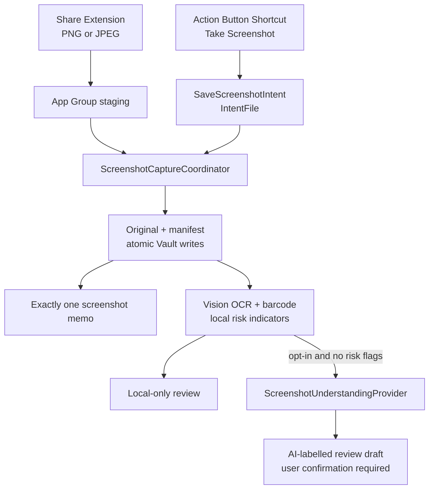

# ADR-0012: Action Button screenshot capture and evidence-first understanding

- **Status:** Accepted
- **Date:** 2026-08-25
- **Supersedes:** [ADR-0011](ADR-0011-action-button-voice-capture.md) as the primary
  Action Button assignment; voice remains a separate App Shortcut
- **Implementation:** [GitHub issue #876](https://github.com/getyak/daypage/issues/876)

> Reconciliation note (2026-10-12): this document is the accepted decision recovered
> from the unpublished `876-action-button-screenshot` source and reconciled with the
> earlier proposed ADR text that landed on `main`. Where the proposal and the
> executable implementation differ, this record follows the executable
> implementation (`ScreenshotCaptureCoordinator`, `ScreenshotCaptureStore`, the
> manifest phase machine, and their tests). The earlier proposal's deferred ideas —
> an Apple on-device multimodal provider (Foundation Models) and Visual
> Intelligence "find related DayPage" retrieval — remain future work and are not
> claimed by this implementation.

## Context

DayPage needs a low-friction way to preserve the screen the user is looking at and turn
it into searchable memory. The iPhone Action Button can run a user-selected Shortcut or
App Shortcut, but a third-party app does not receive arbitrary screen pixels from the
hardware event. `UIApplication.userDidTakeScreenshotNotification` has no image payload,
and ReplayKit is a recording/broadcast framework rather than a one-frame ingest API.

A screenshot may contain chats, one-time codes, credentials, balances, health data, or
identity documents. Therefore "save locally" and "send to a third-party model" are two
different decisions. Capture must remain complete and recoverable while offline, when AI
is disabled, or when a provider fails.

## Decision

Use a **two-entry, one-pipeline** architecture:

1. The primary Action Button workflow is an iOS Shortcut:
   `Take Screenshot -> Save Screenshot to DayPage`.
2. `SaveScreenshotIntent` accepts the previous action's PNG/JPEG `IntentFile`; it does
   not attempt to capture the screen itself and does not foreground DayPage.
3. A Share Extension is the explicit fallback for an existing screenshot or for users
   who want to inspect/crop before saving. It atomically stages the image in the App
   Group and the main app removes that staged copy only after Vault ingest succeeds.
4. Both entries converge on `ScreenshotCaptureCoordinator` and the same durable,
   idempotent manifest/memo state machine.
5. Local Vision OCR and barcode extraction happen before optional cloud understanding.
6. Cloud understanding is off by default, provider-named, reversible, and snapshotted
   on each capture. Locally detected sensitive categories are never uploaded.
7. Model output is an evidence-linked draft. DayPage never treats it as user-authored
   intent and never executes a suggested action without confirmation.



## Durable ingest contract

- Accept PNG/JPEG only, at most 25 MB and 50 megapixels.
- Preserve the original bytes at `raw/assets/screenshots/`; never replace a screenshot
  with the lossy analysis derivative.
- Store a JSON manifest at `raw/assets/.screenshot-captures/` with capture UUID, exact
  memo UUID, SHA-256, source, dimensions, consent snapshot, phase, evidence, and result.
- The original and manifest are durable before the raw memo is appended. If memo append
  fails, `ingestPending` reconciliation creates that exact memo later.
- Treat the same SHA-256 received within 30 seconds as an accidental duplicate. Retries
  return the existing capture and cannot append another memo.
- Write all files atomically and apply complete file protection where the OS supports it.
- The Share Extension's App Group directory is short-lived handoff storage, not a second
  source of truth.
- One multi-step operation (receive, memo ingest, reconciliation, delete/undo) is bound
  to a single captured Vault root. Manifests, originals, and raw memos can never be
  split across two vaults if the Vault root changes mid-operation.

The lifecycle is:

```text
stored -> ingestPending | ingested -> extracting -> localOnly | queued
queued -> needsConsent | understanding -> ready | pendingNetwork | failed
```

HTTP 408, 429, 5xx and transport errors remain retryable. A delete uses the existing
five-second Today undo window; files are removed only after the exact raw memo is still
absent when that window closes.

## Evidence, interpretation, and user meaning

DayPage stores three distinct layers:

1. **Evidence:** original screenshot, capture time, OCR regions/confidence, and barcode
   observations.
2. **AI interpretation:** labelled title, content kind, summary, visual description,
   entities, warnings, evidence references, provider/model, and prompt version.
3. **User meaning:** the optional answer to "为什么保存它？". Only this layer states the
   user's personal intent as fact.

Suggested actions are typed drafts with bounded confidence and
`requiresConfirmation = true`, regardless of provider output. URLs and QR payloads stay
inert until the user explicitly acts.

## Privacy and provider boundary

Vision runs locally for every supported screenshot. Deterministic checks flag likely
one-time codes, credentials, financial data, health data, and identity data. A flag
forces `localOnly`; absence of a flag is not represented as a safety guarantee.

The cloud setting is independent of the existing global AI switch and defaults to off.
Turning it off changes queued work to local-only. The Settings copy names OpenAI and
states that a metadata-free derivative is sent only when enabled. Screenshot pixels and
OCR text are untrusted evidence, never prompt instructions.

Consent is snapshotted per capture and re-checked before every upload. Revoking consent
(`keepLocal`) or the global setting while a request is in flight invalidates that stale
completion: the response is discarded and the capture stays local-only.

`ScreenshotUnderstandingProvider` is provider-neutral. The initial OpenAI adapter uses
the Responses API with:

- image input plus bounded OCR evidence;
- top-level safety instructions separated from the user evidence;
- a strict structured-output schema;
- `store: false` and no conversation/background response state;
- a metadata-free JPEG derivative, maximum dimension 1600 px;
- no diary history attached to the request.

`store: false` is not described as zero provider retention. Product disclosure must stay
consistent with the provider account and data-control terms.

## User experience

The intent reports success only after the original, manifest, and raw memo are safe. It
uses concise feedback such as:

- `截图已保存，打开 DayPage 后生成 AI 摘要`
- `截图已保存；检测到敏感内容，只在本机处理`
- `原图已安全保存，DayPage 稍后会补入今天`
- `这张截图刚刚已经保存过了`

Today shows the screenshot in the normal feed with an explicit phase badge. Local OCR
can provide immediate value before AI is available. Generated summaries and suggested
actions are labelled as AI output; the card offers retry, keep-local, and "为什么保存它？"
controls. Network/provider errors never hide or delete the original.

The setup UX must explain that users assign a Shortcut to the Action Button themselves.
DayPage cannot silently replace an existing assignment. The Share Sheet is a fallback,
not the primary path, because it costs more taps.

## Alternatives rejected

- **Fetch the latest Photos item:** broader permission, race conditions, and risk of
  importing the wrong screenshot.
- **Observe screenshot notifications:** no image payload and no reliable background
  handoff.
- **ReplayKit:** captures a recording rather than the one requested frame and imposes the
  wrong lifecycle and consent model.
- **Run the LLM entirely in Shortcuts:** weakens idempotency, retry, schema versioning,
  provider disclosure, and reconciliation with an exact memo.
- **Share Extension only:** reliable fallback, but too many taps for the Action Button's
  quick-capture promise.
- **Upload by default:** conflicts with data minimization and makes ordinary capture
  dependent on network/provider availability.

## Verification and rollout

Automated gates cover validation, exact-byte preservation, duplicate delivery, one-memo
ingest (including concurrent callers), Share inbox handoff, local risk policy,
cloud-disabled behavior, consent revocation while work is in flight, single-Vault
binding across delete/undo, retryable rate limits, strict provider requests,
prompt-injection boundaries, confidence clamping, and forced action confirmation.

Simulator can prove compilation, embedding, app launch, and ordinary review UI. Release
requires a signed real-device matrix for iOS 18 through current:

- warm, cold, terminated, locked, and first-unlock states;
- first-run screenshot permission and Action Button Shortcut setup;
- normal, landscape, Chinese/mixed-language, DRM/secure screens;
- offline, timeout, 429, malformed provider response, consent revocation;
- duplicate invocation, disk full, and crashes between original/manifest/memo writes;
- Share Extension with the production App Group provisioning profile.

The Action Button/Shortcuts handoff, lock-screen behavior, DRM output, and provisioning
cannot be truthfully signed off using Simulator alone. None of that device matrix is
signed off by the source recovery in `docs/engineering/remote-recovery.md`; issue #876
device acceptance stays open until it runs on hardware.

## Sources

- [Apple Support: Run shortcuts with the Action button](https://support.apple.com/guide/shortcuts/apdfea15680b/ios)
- [Apple Developer: Hardware interactions](https://developer.apple.com/documentation/appintents/hardware-interactions)
- [Apple Developer: IntentFile](https://developer.apple.com/documentation/appintents/intentfile)
- [Apple Developer: userDidTakeScreenshotNotification](https://developer.apple.com/documentation/uikit/uiapplication/userdidtakescreenshotnotification)
- [Apple Developer: ReplayKit](https://developer.apple.com/documentation/replaykit)
- [Apple Developer: VNRecognizeTextRequest](https://developer.apple.com/documentation/vision/vnrecognizetextrequest)
- [Apple: App Extension Programming Guide — Share](https://developer.apple.com/library/archive/documentation/General/Conceptual/ExtensibilityPG/Share.html)
- [Apple HIG: Generative AI](https://developer.apple.com/design/human-interface-guidelines/generative-ai)
- [OpenAI: Create a response](https://developers.openai.com/api/reference/cli/resources/responses/methods/create)
- [OpenAI: GPT-5.4 mini](https://developers.openai.com/api/docs/models/gpt-5.4-mini)
- [OpenAI: Data controls](https://developers.openai.com/api/docs/guides/your-data)
